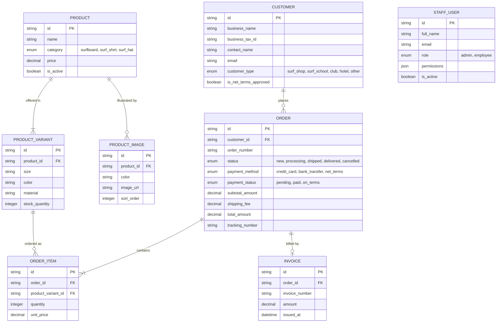

# ERD: אתר הזמנות סיטונאיות ומערכת ניהול לעסק ציוד גלישה

**מקור:** PRD.md (2026-11-24) · **סטטוס:** גרסה 2. נוסף `Product.category` (גלשנים, חולצות גלישה, כובעי גלישה).
הגרסה הקודמת: `ERD.pdf`. ב-PRD אין מספרי User Stories, ולכן המקור של כל ישות הוא מספר הסעיף ב-PRD (למשל §5.1).

## 1. Overview

מערכת עסקאות (transactional) למכירה סיטונאית. במרכז המודל יש **קטלוג** (דגם ← וריאציות במלאי), שבו כל דגם שייך ל**קטגוריה**: גלשן, חולצת גלישה או כובע גלישה. סביבו יש **לקוחות עסקיים** ו**הזמנות** (הזמנה ← שורות הזמנה ← חשבונית). בנוסף יש **משתמשי צוות** עם תפקידים והרשאות לניהול המערכת. דוחות המכירות והמלאי מחושבים מהנתונים הקיימים, ואין להם ישות נפרדת.

## 2. Mermaid Diagram

## 3. Entities

### StaffUser
**Purpose:** משתמש צוות במערכת הניהול: מנהל או עובד. **Source:** §4, §6.7

| Field | Type | Required | Notes |
|---|---|---|---|
| id | string | yes | Primary key |
| full_name | string | yes | |
| email | string | yes | ייחודי, משמש להתחברות |
| password_hash | string | yes | הסיסמה שמורה מוצפנת (§8) |
| role | enum: [admin, employee] | yes | |
| permissions | json | no | ההרשאות של העובד כפי שהמנהל הגדיר. לא בשימוש עבור admin |
| is_active | boolean | yes | |
| created_at | datetime | yes | |
| updated_at | datetime | yes | |

### Customer
**Purpose:** לקוח עסקי שנרשם ומזמין באתר. **Source:** §3, §5.4, §6.4

| Field | Type | Required | Notes |
|---|---|---|---|
| id | string | yes | Primary key |
| business_name | string | yes | |
| business_tax_id | string | yes | ח.פ / ע.מ |
| contact_name | string | yes | |
| email | string | yes | ייחודי, משמש להתחברות |
| phone | string | no | |
| password_hash | string | yes | |
| customer_type | enum: [surf_shop, surf_school, club, hotel, other] | no | §3 |
| address | text | no | כתובת ברירת המחדל של העסק |
| is_net_terms_approved | boolean | yes | ברירת מחדל false. רק המנהל מאשר (§6.4) |
| net_terms_days | integer | no | למשל 30 (שוטף+30) |
| created_at | datetime | yes | |
| updated_at | datetime | yes | |

### Product
**Purpose:** דגם בקטלוג: גלשן, חולצת גלישה או כובע גלישה. **Source:** §5.1, §6.1

| Field | Type | Required | Notes |
|---|---|---|---|
| id | string | yes | Primary key |
| name | string | yes | |
| **category** | **enum: [surfboard, surf_shirt, surf_hat]** | **yes** | **חדש. קובע את הקטגוריה בקטלוג ואת הסינון (§5.1)** |
| price | decimal | yes | מחיר אחד לדגם, זהה לכל הווריאציות ולכל הלקוחות |
| is_active | boolean | yes | האם הדגם מוצג באתר |
| created_at | datetime | yes | |
| updated_at | datetime | yes | |

### ProductVariant
**Purpose:** שילוב מסוים של מידה, צבע וחומר של דגם, עם מלאי משלו. המחיר נלקח מהדגם. **Source:** §5.1, §5.2, §6.1

| Field | Type | Required | Notes |
|---|---|---|---|
| id | string | yes | Primary key |
| product_id | reference: Product | yes | |
| size | string | yes | הערכים לפי הקטגוריה: אורך גלשן (7'0"), S–XXL לחולצות, "מידה אחת" או S/M/L לכובעים |
| color | string | yes | |
| material | string | no | למשל אפוקסי, לייקרה, כותנה. ב-PRD החומר מופיע כאופציונלי |
| stock_quantity | integer | yes | ≥ 0. יורד אוטומטית כשמתקבלת הזמנה |
| created_at | datetime | yes | |
| updated_at | datetime | yes | |

### ProductImage
**Purpose:** תמונה של דגם בצבע מסוים. כל המידות באותו צבע מציגות את אותן תמונות. **Source:** §5.1, §6.1

| Field | Type | Required | Notes |
|---|---|---|---|
| id | string | yes | Primary key |
| product_id | reference: Product | yes | |
| color | string | yes | חייב להתאים לצבע של אחת הווריאציות של הדגם |
| image_url | string | yes | |
| sort_order | integer | yes | סדר התצוגה |
| created_at | datetime | yes | |
| updated_at | datetime | yes | |

### Order
**Purpose:** הזמנה של לקוח, כולל מצב התשלום ומצב המשלוח. **Source:** §5.2, §5.3, §6.2, §6.3

| Field | Type | Required | Notes |
|---|---|---|---|
| id | string | yes | Primary key |
| customer_id | reference: Customer | yes | |
| order_number | string | yes | ייחודי, מוצג ללקוח |
| status | enum: [new, processing, shipped, delivered, cancelled] | yes | §6.2 |
| payment_method | enum: [credit_card, bank_transfer, net_terms] | yes | net_terms מותר רק ללקוח מאושר |
| payment_status | enum: [pending, paid, on_terms] | yes | §6.2 |
| payment_due_date | date | no | רלוונטי רק לתנאי תשלום |
| subtotal_amount | decimal | yes | סכום שורות ההזמנה, כולל מע"מ |
| shipping_fee | decimal | yes | 0 אם subtotal_amount מעל 10,000 ₪ (כולל מע"מ). אחרת 300 ₪ (§5.2) |
| total_amount | decimal | yes | subtotal_amount + shipping_fee |
| shipping_address | text | yes | ישראל בלבד (§5.2) |
| shipping_carrier | string | no | חברת השילוח |
| tracking_number | string | no | §6.3 |
| shipped_at | datetime | no | |
| created_at | datetime | yes | |
| updated_at | datetime | yes | |

### OrderItem
**Purpose:** שורה בהזמנה: וריאציה וכמות. **Source:** §5.2

| Field | Type | Required | Notes |
|---|---|---|---|
| id | string | yes | Primary key |
| order_id | reference: Order | yes | |
| product_variant_id | reference: ProductVariant | yes | |
| quantity | integer | yes | ≥ 1, ולא יותר מהמלאי בזמן ההזמנה |
| unit_price | decimal | yes | המחיר נשמר כפי שהיה בזמן ההזמנה |
| created_at | datetime | yes | |
| updated_at | datetime | yes | |

### Invoice
**Purpose:** חשבונית שהופקה להזמנה. **Source:** §6.5

| Field | Type | Required | Notes |
|---|---|---|---|
| id | string | yes | Primary key |
| order_id | reference: Order | yes | ייחודי: חשבונית אחת להזמנה |
| invoice_number | string | yes | ייחודי |
| amount | decimal | yes | |
| issued_at | datetime | yes | |
| document_url | string | no | קובץ החשבונית |
| created_at | datetime | yes | |
| updated_at | datetime | yes | |

## 4. Relationships

**Product → ProductVariant:** one-to-many (לפחות וריאציה אחת)
- Description: לכל דגם יש וריאציות של מידה, צבע וחומר.
- Cascade: restrict אם לאחת הווריאציות יש שורות הזמנה. אחרת cascade.
- Source: §5.1

**Product → ProductImage:** one-to-many
- Description: לכל דגם יש אפס תמונות או יותר, וכל תמונה משויכת לצבע מסוים.
- Cascade: cascade
- Source: §5.1

**Customer → Order:** one-to-many
- Description: לקוח מבצע הזמנות.
- Cascade: restrict, כדי לשמור את היסטוריית ההזמנות.
- Source: §5.4, §6.4

**Order → OrderItem:** one-to-many (לפחות שורה אחת)
- Description: הזמנה מכילה שורות הזמנה. הזמנה אחת יכולה לכלול מוצרים מכמה קטגוריות.
- Cascade: cascade
- Source: §5.2

**ProductVariant → OrderItem:** one-to-many
- Description: אותה וריאציה יכולה להופיע בהזמנות רבות.
- Cascade: restrict
- Source: §5.2

**Order → Invoice:** one-to-zero-or-one
- Description: לכל הזמנה מופקת לכל היותר חשבונית אחת.
- Cascade: restrict
- Source: §6.5

## 5. Coverage Map

| PRD Section | Entities Involved |
|---|---|
| §4 משתמשים והרשאות | StaffUser, Customer |
| §5.1 קטלוג מוצרים וקטגוריות | Product (category), ProductVariant, ProductImage |
| §5.2 הזמנה | Order, OrderItem, ProductVariant |
| §5.2 דמי משלוח | Order (subtotal_amount, shipping_fee) |
| §5.3 תשלום | Order, Customer |
| §5.4 חשבון לקוח | Customer, Order |
| §6.1 ניהול מלאי ומוצרים | Product, ProductVariant, ProductImage |
| §6.2 ניהול הזמנות | Order |
| §6.3 משלוחים | Order |
| §6.4 ניהול לקוחות | Customer, Order |
| §6.5 חשבוניות | Invoice |
| §6.6 דוחות | ⚠️ אין ישות. הדוחות (כולל לפי קטגוריה) מחושבים מ-Order, OrderItem, ProductVariant ו-Product |
| §6.7 ניהול משתמשים | StaffUser |
| §7 אינטגרציות | ⚠️ אין ישות. הספקים עוד לא נבחרו |

## 6. Open Questions

- האם ההרשאות של העובדים הן רשימה קבועה של יכולות, או "תפקידים" שהמנהל מגדיר? כרגע הן שמורות כ-json על המשתמש.
- האם למשלוח צריך סטטוס נפרד מסטטוס ההזמנה? כרגע סטטוס ההזמנה מכסה גם אותו.
- האם הקטגוריות קבועות (enum), או שהמנהלת תרצה להוסיף קטגוריות בעצמה? אם כן, תידרש טבלת Category נפרדת.
